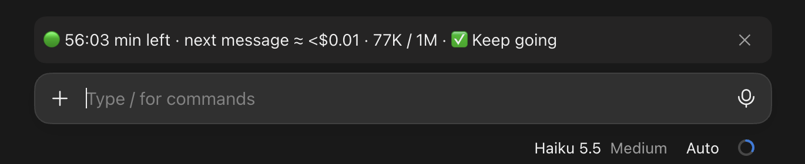
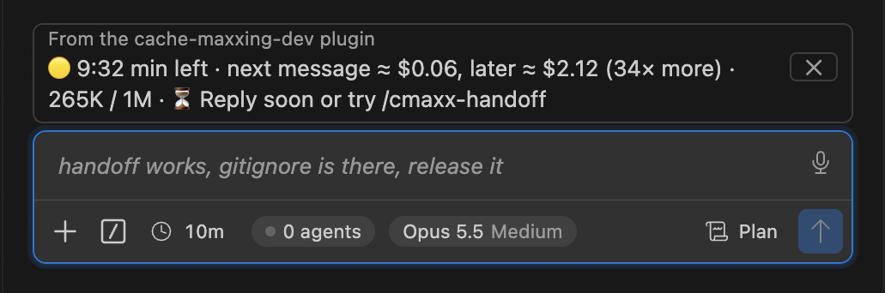
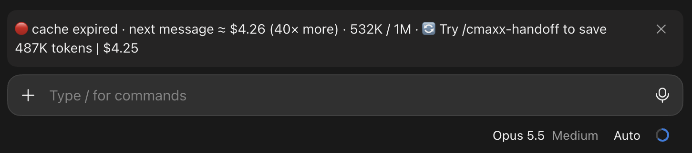
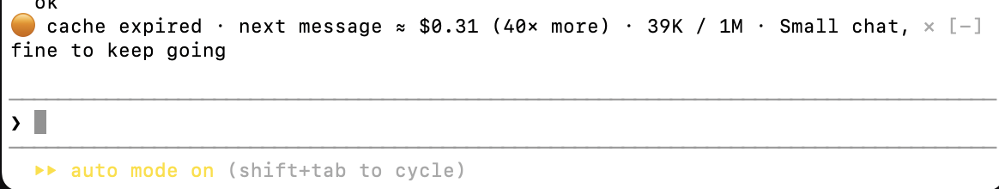

<div align="center">


# cache-maxxing

**See when Claude's prompt cache expires, and what your next message will cost, before you send it.**

[](CHANGELOG.md)
[](LICENSE)
[](https://code.claude.com/docs/en/discover-plugins)

</div>

---

## This fork

Personal fork of [5m0k3/cache-maxxing](https://github.com/5m0k3/cache-maxxing) 0.5.1. Where this README says Haiku, this fork uses Sonnet. Changes:

- `/handoff` writes the brief with **Sonnet** (not Haiku) and reads a longer tail of the chat: 400 messages, 400,000 characters.
- The transcript is cut at whole messages, never inside a quoted block.
- A facts-only brief (the model call failed) no longer clears the chat.
- Commands are `/handoff`, `/cache` and `/cache-stats` (upstream: `/cmaxx-handoff`, `/cmaxx`, `/cmaxx-stats`).
- There is no update command. The price list refreshes itself at session start, at most once a day, with one GET of upstream's `prices.json`; nothing is sent. No version check and no code install: merge upstream with git after a review.
- Where the text below still names an update command, this section is the correct one.

## About

Ever feel like your Claude subscription quota disappears way faster than it should? Usually, it's not how **much** you're building - it's **when** you hit Send.

Claude keeps your chat "warm" only for a while so follow-up messages barely dent your limit. But wait too long between messages, and Claude has to re-read your entire chat history at full cost - **up to 80× more quota** than a normal reply.

**cache-maxxing** puts an easy-to-read bar right above your chat box (in the desktop app, VS Code, and terminal) to protect your quota while you build:

- **Know before you hit Send:** See a live countdown timer and whether your next message is cheap (🟢), running out of time (🟡), or about to take a huge bite out of your limit (🔴).
- **Never lose your flow with `/handoff`:** When a long chat gets too expensive to continue, run one command to hand off a smart summary of your progress into a fresh chat—no re-explaining your project, and no massive quota spike.
- **Zero setup headaches, zero slowdown:** Everything is calculated right on your machine using numbers Claude Code already tracks. The bar sends nothing anywhere.

| | |
|---|---|
|  |  |
| **🟢 Cache active.** Messages are cheap right now. | **🟡 Ending soon.** The cheap moment to reply. |
|  |  |
| **🔴 Expired.** What a rebuild costs, and what a handoff saves. | **🟠 Expired.** But the rebuild cost is low. |

## Features

| | |
|---|---|
| ⏱️ **Live countdown** | Minutes left on the cache, ticking every second; it survives restarts, sleep and switching chats. |
| 💲 **Next-message cost** | In dollars (API prices) or as "× more" (better for subscriptions), plus how full the chat is (`290K / 1M`). |
| 🚦 **One clear tip** | 🟢 keep going · 🟡 reply soon · 🟠 expired small chat, fine · 🔴 expired, with what a handoff would save. |
| 🔔 **One pop-up** | A single warning when a big chat's cache expires, and a heads-up if you send into it. Your message is never stopped. |
| 🔄 **`/handoff`** | Haiku (effort: High) writes a briefing of the chat; a fresh chat picks up from it. The expired chat is never resent to the main model. |
| 📊 **`/cache-stats`** | Money and tokens saved, cache hit rate, rebuilds paid: for this chat and for all chats. |
| ⬆️ **`/cache-update`** | Updates the plugin, or at least its model and price list, so new models are priced on day one. |
| 🔒 **Local by default** | No network and no model calls, except the two commands above, and only when you run them. |


## Install

Requires a recent Claude Code: the desktop app, the VS Code extension, or the CLI. It's tested on 2.1.325 and later.

**Any application**  
Just paste this repository's link (https://github.com/5m0k3/cache-maxxing) in the chat window and ask Claude to install it for you.

or see below for your specific application:

**Desktop app**
1. Click **+** next to the chat box, then **Plugins** → **Manage Plugins**.
2. On top right press **+ Add** → **Add marketplace** → **Add from a repository** and enter `5m0k3/cache-maxxing`.
3. **Add plugin** → cache-maxxing.

**Terminal or VS Code** (at the Claude Code prompt)

```
/plugin install cache-maxxing --marketplace 5m0k3/cache-maxxing
```

Answer `y` to add the marketplace and press Enter for the user scope. The bar shows after your next message (may need a restart).

## Usage

| Command | What it does |
|---|---|
| `/cache` | Hide or show the bar in this chat (the **✕** on the bar hides it too). |
| `/handoff` | Write a briefing of this chat with Haiku and start a fresh chat from it. (Doesn't trigger the old chat's model) |
| `/cache-stats` | Show savings, cache hit rate, rebuilds and replies: this chat and all chats. |
| `/cache-update` | Update to the latest version, or refresh the model and price list. |

What each light means, the exact texts and the rules behind them: [How the bar decides](#how-the-bar-decides).

## Settings

In the plugin's settings, under cache-maxxing:

| Setting | Default | What it changes |
|---|---|---|
| Rebuild limit ($) | 0.50 | Above this rebuild cost, the bar suggests a handoff instead of carrying on. |
| Warning time (minutes) | 15 | How early the bar turns 🟡 before the 1-hour cache expires. |
| Long chat size (tokens) | 300000 | When the 🟢 bar starts suggesting a handoff once you're done. |
| Show cost as | dollars | `times` shows "40× more" instead of dollars, which suits subscription plans. |
| Memory time | auto | `auto` is 1 hour (every Claude subscription chat). Choose `5` with an API key. |

## Keep it updated

Plugins from GitHub don't update by themselves: Claude Code auto-updates only Anthropic's own marketplaces by default.

- **Once:** in a terminal session, `/plugin` → **Marketplaces** → cache-maxxing → **Enable auto-update**.
- **Any time:** run `/cache-update`. If a newer version is out, it updates the plugin (in the terminal) or tells you how (desktop app, VS Code). Either way it refreshes the model and price list, so a newly released model is priced at once.
- A chat on a newly launched model ends with `new model? try /cache-update`.

## How the bar decides

From top to bottom, the first rule that fits:

1. No reply yet in this chat: ⚪️ "cache-maxxing will start after you send a message".
2. Cache expired or reset, and the rebuild costs more than the rebuild limit: 🔴, suggesting `/handoff` with what it would save.
3. Cache expired or reset, rebuild below the limit: 🟠 small chat, fine to keep going.
4. Under 15 minutes left on the 1-hour cache: 🟡 reply soon.
5. Active, but the chat is past the long-chat size: 🟢 with a handoff suggestion for when you're done.
6. Otherwise: 🟢 keep going.

```
🟢 48 min left · next message ≈ $0.01 · 50K / 1M · ✅ Keep going
🟡 12:30 min left · next message ≈ $0.05, later ≈ $1.82 (40× more) · 228K / 1M · ⏳ Reply soon or try /handoff
🔴 cache expired · next message ≈ $2.32 (40× more) · 290K / 1M · 🔄 Try /handoff to save 232K tokens | $2.21
```

Costs are estimates at standard API list prices, and a floor: a reply that uses tools sends several requests. On a subscription you don't pay these dollars; read them as how much of your usage a message takes. "Active" means very likely active: in our measurements about 2 in 100 messages missed the cache even within the time limit.

## Privacy

- **The bar sends nothing anywhere and never calls a model.** Everything it shows is worked out on your computer.
- **Two commands reach outside, only when you run them:**
  - `/handoff` sends Claude Haiku an abbreviated copy of the chat (the last 120 messages, long ones cut, tool output left out). The briefing is saved in your project under `.claude/handoffs/`, which gets its own `.gitignore`, so briefings are never committed.
  - `/cache-update` downloads this plugin's version number and price list from this repository and sends nothing. GitHub sees your IP address, as for any download.
- **Stored on your computer:** a small record per chat (time of the last reply, chat size, model) for 7 days, and counts for `/cache-stats` (numbers only, each chat's for 90 days, the totals for good). **Never the chat's text!**

## Limitations

- If your organization blocks Haiku, `/handoff` writes a facts-only briefing that keeps your last message, and says why.
- The handoff's saving is an estimate: Haiku's share, the brief and a fresh chat's start are learned from your own handoffs and fresh chats (medians), priced as Claude Haiku 5.5. After `/compact` the bar estimates the chat's new size the same way until the next reply.
- Switching model and back within the hour shows "cache reset", although the first model's cache may still be warm.
- `/cache-stats` reads an older chat's history from its transcript only up to 4 MiB; a bigger chat that started before you installed the plugin is counted from when the plugin first saw it.
- A brand-new chat in the desktop app shows the bar only after your first message: the app starts the chat, and its plugins, at that point.

## FAQ

**Why no cache warmer?**  
Anthropic's Consumer Terms bar access by "automated or non-human means" unless via an API key or explicitly permitted, and its Claude Code terms assume "ordinary, individual usage". A background keep-alive ping isn't clearly allowed by either, and accounts can be suspended "without notice", so we won't risk yours.  
Use /handoff instead: a small fresh chat with the context of old one.  

**Does it cost anything to run?** The bar, no. `/handoff` makes one small Haiku call, typically about a cent at API prices.

**I'm on a subscription. Are the dollar amounts real?** They're API list prices, a way to compare. Set **Show cost as** to `times` to see "40× more" instead.

## Contributing

Issues and pull requests are welcome. See [CONTRIBUTING.md](CONTRIBUTING.md) for setup, tests and the project rules, and [SECURITY.md](SECURITY.md) to report a vulnerability privately. Changes are listed in [CHANGELOG.md](CHANGELOG.md).

## License

[MIT](LICENSE) © 5m0k3
